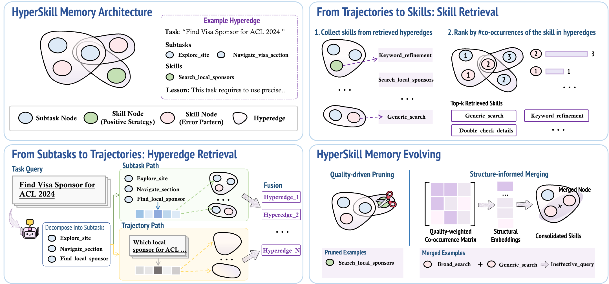

<div align="center">

# HyperSkill: Self-Evolving LLM Agents via Hypergraph-Structured Skill Memory

[](https://www.python.org/)


</div>



## Overview

Experiential memory lets an agent reuse what it learned from its own past
trajectories. Designing it means answering three questions at once — *what to
store*, *how it is structured and retrieved*, and *how it evolves*. Most systems
answer only one: they keep trajectories, insights, or skills as isolated
entries, retrieve them by flat embedding similarity, and grow without curation.

**HyperSkill** answers all three with a single structure. Memory is a
hypergraph `G = (V, E)` over two node types — **subtask** steps and reusable
**skills** — where each hyperedge binds the subtasks and skills of one
trajectory together with a distilled lesson and a utility score. A trajectory is
an *n*-ary association, not a flat record, and a hyperedge preserves it natively.

Three consequences, shown in the figure above:

- **Hyperedges keep the compositional context** that flat stores discard. Skills
  from successful trajectories become positive strategies; skills from failed
  ones become error patterns to avoid.
- **Dual-path retrieval.** A new task is decomposed into subtasks and matched
  against stored subtask nodes (surfacing trajectories that share procedural
  structure even when the wording differs), while the task description is
  matched directly against hyperedge embeddings (surfacing trajectories with
  similar high-level semantics). The two candidate sets are fused, and skills are
  ranked by **how often they co-occur** across the retrieved hyperedges — a
  structural signal semantic similarity alone cannot provide.
- **Structure-informed evolution.** Periodic maintenance prunes nodes that are
  retrieved often but consistently fail, and merges redundant skills via
  quality-weighted propagation over the hypergraph.

## Setup

### 1. Environment

```bash
git clone <repository-url> HyperSkill
cd HyperSkill

conda env create -f environment.yml
conda activate hyperskill
```

Or install into an existing environment with `pip install -r requirements.txt`.

A few dependencies are optional and imported lazily — install them only if you
need the corresponding inputs:

```bash
pip install biopython            # .pdb protein-structure attachments
pip install crawl4ai             # alternative page-crawling backend
pip install duckduckgo-search    # alternative web-search backend
```

### 2. Environment variables

```bash
cp .env.example .env
```

Then edit `.env` and fill in your own values. The template lists every variable
the runners read: the backbone endpoint, the judge used for scoring, and the web
search / page crawling services. Nothing is hard-coded — `.env` is the only
place credentials live, and it is git-ignored.

To serve an open-source backbone locally instead, launch it with vLLM and point
the runner at it with `--model_base_url` / `--model_name`.

### 3. Datasets

Download the three benchmarks and place them under `data/`.

**GAIA** — 165 validation tasks. From
[gaia-benchmark/GAIA](https://huggingface.co/datasets/gaia-benchmark/GAIA):

```bash
mkdir -p data/gaia/validation
# place metadata.jsonl and the attached files under data/gaia/validation/
```

**WebWalkerQA** — 170-task subset. From
[callanwu/WebWalkerQA](https://huggingface.co/datasets/callanwu/WebWalkerQA):

```bash
mkdir -p data/webwalkerqa
# download main-00000-of-00001.jsonl -> data/webwalkerqa/webwalkerqa_main.jsonl
cd data/webwalkerqa && python sample_webwalkerqa.py     # samples 170 tasks, seed 42
```

**xBench** — 100 DeepSearch tasks. From
[xbench-ai/xbench-evals](https://github.com/xbench-ai/xbench-evals):

```bash
git clone https://github.com/xbench-ai/xbench-evals.git xbench-evals-main
```

Expected layout:

```
data/gaia/validation/metadata.jsonl
data/webwalkerqa/webwalkerqa_subset_170.jsonl
xbench-evals-main/data/DeepSearch.csv
```

## Experiments

One runner per benchmark. Pass `--memory_provider hyperskill` to enable the
memory, or omit it for the No-Memory baseline.

```bash
# GAIA
python runners/run_gaia.py \
    --infile ./data/gaia/validation/metadata.jsonl \
    --outfile results/gaia/results.jsonl \
    --max_steps 40 --concurrency 1 \
    --memory_provider hyperskill

# WebWalkerQA
python runners/run_webwalkerqa.py \
    --infile ./data/webwalkerqa/webwalkerqa_subset_170.jsonl \
    --outfile results/webwalkerqa/results.jsonl \
    --max_steps 40 --concurrency 1 \
    --memory_provider hyperskill

# xBench
python runners/run_xbench.py \
    --infile ./xbench-evals-main/data/DeepSearch.csv \
    --outfile results/xbench/results.jsonl \
    --max_steps 40 --concurrency 1 \
    --memory_provider hyperskill
```

To run a locally served backbone, add:

```bash
    --model_base_url "http://localhost:8000/v1" \
    --model_name "Qwen/Qwen3-30B-A3B-Instruct-2507"
```

## Repository structure

```
hyperskill/               core memory system
  hypergraph_core.py      hypergraph store, dual-path retrieval, pruning, merging
  provider.py             per-task interface: retrieve before, ingest after
  prompts.py              decomposition, extraction and merge prompts
  memory_types.py         request / response types
  config.py               default hyperparameters
  base_memory.py          provider interface

FlashOAgents/             tool-calling agent used for the experiments
runners/                  one evaluation runner per benchmark
data/                     dataset preparation helpers
```

`hyperskill/` is self-contained: it depends only on `numpy`, `networkx` and
`sentence-transformers`, and can be dropped into another agent loop
independently of the agent framework shipped here.


## Acknowledgments

This codebase builds on [MemEvolve](https://github.com/bingreeky/MemEvolve) for
the evaluation protocol and on the Flash-Searcher agent framework. We thank the authors of GAIA, WebWalkerQA and xBench for their
benchmarks, and the authors of the memory systems we compare against.

## License

Released under the Apache License 2.0.
